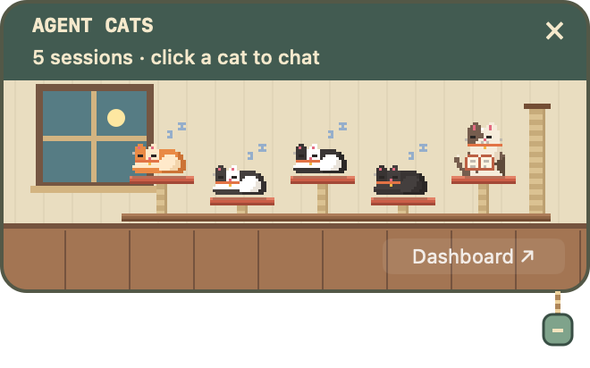

<h1 align="center">Agent Cats</h1>

<p align="center">
  <b>Pixel-art cats under the macOS menu bar that watch your Claude Code and Codex sessions, tell you what they need, and let you answer without switching windows.</b>
</p>

<p align="center">
  
</p>

Each running agent session gets its own cat. The cat's pose shows what the agent is doing. When the agent needs you, the cat speaks up in a speech bubble: a question with its options, a permission request with Allow and Deny, or a finished task with the agent's last reply. You can answer from the bubble, and the reply goes straight back to the agent.

<p align="center">
  
</p>

<sub>The bubbles above are rendered from sample sessions by the app's own drawing code, so the text is illustrative.</sub>

---

## Contents

- [Features](#features)
- [Requirements](#requirements)
- [Installation](#installation)
- [Setting up hooks](#setting-up-hooks)
- [Using Agent Cats](#using-agent-cats)
- [How replies reach the agent](#how-replies-reach-the-agent)
- [Settings and data](#settings-and-data)
- [Troubleshooting](#troubleshooting)
- [How it works](#how-it-works)
- [Development](#development)
- [Project layout](#project-layout)
- [Status and limitations](#status-and-limitations)
- [Privacy](#privacy)

## Features

- **One cat per session.** Cats sit on perches. Their pose and animation reflect the session's state: working, thinking, waiting for you, done, or asleep. The room grows with your sessions. When there are many, calm sessions doze in a "+N" basket, and cats that need you are never hidden.
- **Talking cats.** Click a cat to open its bubble. Questions come with the agent's options as buttons and a text box for your own answer. Permission requests get Allow and Deny. Finished tasks show the agent's last reply.
- **Cats speak up on their own** when they need permission, ask a question, finish a task, or hit an error. If the room is tucked away (or hidden completely), it drops back down with a soft sound and the cat asks you directly, with a text box to reply. A question stays up until you answer it. A turn that ends with a question ("Want me to open a PR?") counts as a question.
- **Reply without switching windows.** Replies go to the agent through the hook that is waiting on a permission request, or by typing into the session's terminal tab.
- **Jump to any session.** Double-click a cat to bring its terminal tab forward.
- **Dashboard.** See every session's activity history, model, token use, cache hit rate, context-window use, and rate limits, with the project folder one click away.
- **Reviewed approvals.** A Claude permission request shows the complete tool input before you decide. A request left unanswered for two minutes falls back to the agent's normal prompt.
- **Private by design.** Everything stays on your Mac. The app makes no network calls.

## Requirements

- macOS 14 (Sonoma) or later, on Apple Silicon
- Xcode Command Line Tools: `xcode-select --install`. Full Xcode is not required.
- Claude Code and/or Codex installed
- Optional, for typing replies into a terminal: macOS will ask for permission the first time Agent Cats controls Terminal.app or iTerm2. For Terminal.app, you also need to allow Agent Cats under **System Settings › Privacy & Security › Accessibility**.

## Installation

```sh
git clone https://github.com/jahaanb7/agent-cats.git
cd agent-cats
./build.sh                  # compiles with swiftc and signs dist/AgentCats.app
./install.sh                # copies it to ~/Applications/AgentCats.app
open ~/Applications/AgentCats.app
```

`build.sh` stages the whole build before replacing the previous app, so a failed build leaves your working copy intact. To run from the build folder without installing, use `open dist/AgentCats.app`.

Agent Cats appears as a paw icon in the menu bar. Click the paw, or tug the rope that hangs under it, to pull the room down.

Start a `claude` or `codex` session in Terminal or iTerm2, and its cat appears within a few seconds.

## Setting up hooks

Hooks are optional, but they make the app much more accurate. With hooks installed, cats react to events as they happen, and Claude permission requests can be answered from the cat. Without them, Agent Cats reads the session transcripts, and permission prompts are detected only after the fact.

1. Open the dashboard (click the paw, or right-click the room and choose **Open dashboard**).
2. Choose **Set up agent hooks…**. The sheet shows the exact diff before anything changes.
3. Click **Install hooks**.
4. Restart any agent sessions that were already running.

The installer edits only the `hooks` section of `~/.claude/settings.json` and `~/.codex/hooks.json`. Your existing hooks are kept, and each file is backed up with a timestamp first. If a file isn't valid JSON, the installer leaves it alone.

Command-line equivalents:

```sh
./dist/agentcats hooks plan          # show the diff, write nothing
./dist/agentcats hooks install --yes
./dist/agentcats hooks uninstall --yes
```

## Using Agent Cats

| Action | Result |
|---|---|
| Click the paw or tug the rope | Show or hide the room |
| Double-click the rope | Hide Agent Cats completely, rope included. A cat that needs you still pops up; click the paw to bring it back |
| Single-click a cat | Open or close its speech bubble |
| Double-click a cat | Jump to its terminal |
| Right-click a cat | What do you need? · Open terminal · Open project folder · Show details… |
| Right-click the room | Pull down cats / Tuck away · Open dashboard · Large cats / Small cats · Quit |
| `Esc`, or click elsewhere | Close the bubble. An unanswered question stays on its cat. |

The dashboard lists every session with its state and gives full details for the one you select. Use **Show details…** from a cat's menu to open it directly on that session.

## How replies reach the agent

| Situation | What happens |
|---|---|
| Claude permission request, with hooks installed | Allow or Deny answers the waiting hook directly. Text you type is sent to Claude as the reason for a denial. |
| Claude question with 1–9 options | The matching number is typed into the terminal. Your own text is entered through the "type something" option. |
| Questions with several parts, multi-select, or more than 9 options | The bubble offers **Answer in terminal** so you can use the terminal's own picker. |
| Anything else | The text is typed into the session's terminal tab, which is found by its tty. |

Typing is limited to Terminal.app and iTerm2, where Agent Cats can target the exact tab. For other apps and IDEs, the bubble offers to take you to the session instead. Before typing into Terminal.app, Agent Cats checks that the moment hasn't changed and that the right tab is in front. If anything differs, nothing is sent.

## Settings and data

| Item | Location |
|---|---|
| Cat size | Right-click the room → Large cats / Small cats |
| Hide completely when tucked away | Right-click the room, or double-click the rope |
| Pop-up sound | Right-click the room → Play a sound when a cat asks |
| Hook configuration | `~/.claude/settings.json`, `~/.codex/hooks.json` |
| Hook backups | `~/Library/Application Support/AgentCats/backups/` |
| Event socket and spool | `~/Library/Application Support/AgentCats/` (`ev.sock`, `spool.jsonl`) |
| Startup and launch logs | `~/Library/Logs/AgentCats/` |

Session data is read from the agents' own files. Agent Cats doesn't keep a separate copy of your conversations.

## Troubleshooting

- **My rebuild doesn't show up.** Agent Cats runs as a single instance. If an older copy is still running, opening the new build just reveals the old one. Quit the old copy from the paw menu, or run `killall AgentCats`, then open the new build.
- **No cat appears for my session.** Check that the session is running in Terminal, iTerm2, or an IDE, and that hooks are installed. Restart the session after installing hooks.
- **Reply typing doesn't work in Terminal.app.** Confirm that Agent Cats is enabled under Privacy & Security › Accessibility. Then try again. iTerm2 needs only the Automation permission macOS asks for.
- **Startup errors.** See `~/Library/Logs/AgentCats/startup.log`.
- **Hidden launch.** Pass `--background` to the app's executable to start without showing the room.

## How it works

<p align="center">
  
</p>

- **Session sources.** Claude Code transcripts (`~/.claude/projects/*/*.jsonl`) and Codex rollouts (`~/.codex/sessions/**/rollout-*.jsonl`) are followed with FSEvents, so nothing is polled. Running `claude` and `codex` processes are matched to sessions by their launch folder, and process exit is detected with kqueue.
- **Hooks.** `agentcats-hook` receives each hook event and passes it to the app over a Unix socket. Ordinary events are only recorded. A permission request waits for your decision for up to two minutes. If the app isn't running, events are spooled to disk and the agent carries on as normal.
- **State.** Each session moves through idle, thinking, working, permission, question, done, error, and gone. Metrics come only from what the agent reports. Anything it doesn't report shows as a dash.

## Development

```sh
./build.sh                             # build the app, CLI, and hook
./dist/agentcats selftest              # 120 checks: parsers, state, layout, installer, speech logic
./Tests/run-room-tests.sh              # room layout, rope hit testing, visibility
./Tests/run-socket-tests.sh            # Unix-socket hook bridge
./Tests/run-bubble-preview.sh          # renders dist/bubble-preview.png
```

Developer commands:

```sh
./dist/agentcats watch                 # live text view of all sessions
./dist/agentcats sessions --json       # the same data as JSON
./dist/agentcats layout --width 680    # the tree layout for a given width
```

The sprites are defined in `Art/cats.json`: palette-indexed pixel grids for eight coats, with poses and props. Edit that file to change how the cats look, then rebuild.

## Project layout

| Path | Contents |
|---|---|
| `Sources/Core/` | Models, parsers, session store, speech logic, monitor, socket server, hook installer, layout |
| `Sources/App/` | Room and cat tree, speech bubble, terminal navigation and typing, dashboard, app delegate |
| `Sources/Shared/` | Process helpers, paths, and the approval protocol, shared by the app and the hook |
| `Sources/Hook/` | `agentcats-hook`, the hook bridge |
| `Sources/CLI/` | `agentcats`, the developer CLI and self-tests |
| `Art/` | Sprite source (`cats.json`) |
| `Resources/` | App bundle metadata |
| `Tests/` | Room, socket, and bubble test harnesses |
| `docs/images/` | Images used in this README |
| `build.sh`, `install.sh` | Build and install scripts |

## Status and limitations

Agent Cats is early software.

- Session detection, the room, the dashboard, Claude approvals, and the hook installer are covered by automated tests.
- Speech bubbles and reply typing are covered by automated tests and render correctly. The live typing path still needs hands-on testing across Claude Code and Codex versions.
- Codex permission requests can't be answered from the cat yet. Codex replies from the bubble are typed into its terminal, so `y` and `n` are the keys used for approvals.
- Agent Cats only knows about Claude Code and Codex. Other agents are not supported.

## Privacy

Agent Cats runs entirely on your Mac and makes no network connections. It reads the session files that Claude Code and Codex already write, and the hook events those agents send to it. It doesn't upload, collect, or share any of this.
