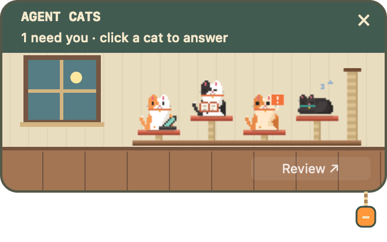
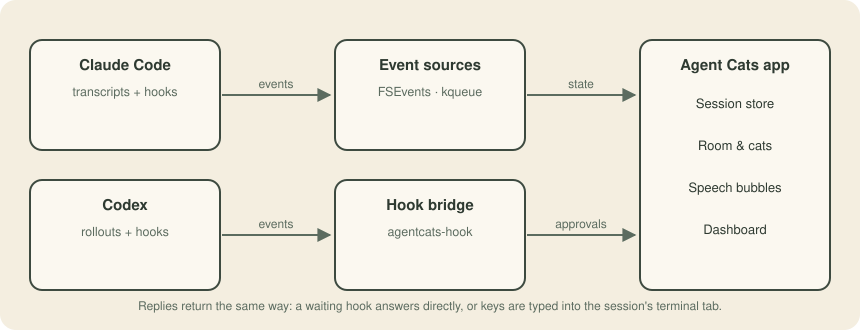

# Agent Cats

**A macOS menu-bar companion that turns your running coding agents into cats.**

Every Claude Code and Codex session gets its own pixel-art cat in a small room under the menu bar. Each cat shows what its agent is doing, speaks up when the agent needs you, and lets you reply without leaving the window you're in.



<p align="center">
  
</p>

---

## Features

- **One cat per session.** Cats sit on perches and animate by state: working, thinking, asleep, waiting for you, or done. The room grows with your sessions. When there are many, calm cats sleep in a "+N" basket and cats that need you are never hidden.
- **Talking cats.** Click a cat for a speech bubble that says what it needs. Questions show the agent's options as buttons, with a text box for your own answer. Permission requests get Allow and Deny. Finished tasks show the agent's last reply.
- **Cats speak up on their own** when they need permission, ask a question, finish a task, or hit an error. Questions stay on screen until you answer.
- **Reply without switching windows.** Replies go to the agent through the hook that is waiting on a permission request, or by typing into the session's terminal tab.
- **Jump to any session.** Double-click a cat to bring its terminal tab forward. Right-click for more options.
- **Dashboard.** See every session with its activity history, model, token use, cache hit rate, context-window use, and rate limits. Open a session's project folder from here too.
- **Reviewed approvals.** Claude permission requests show the full tool input before you decide. A request that isn't answered within two minutes falls back to the agent's normal prompt.
- **Private by design.** Everything stays on your Mac. The app makes no network calls.

## Requirements

- macOS 14 (Sonoma) or later, on Apple Silicon
- Xcode Command Line Tools (`xcode-select --install`). Full Xcode is not required.
- For typing replies into Terminal.app: Accessibility permission for Agent Cats. iTerm2 needs no extra permission.

## Quick start

```sh
git clone https://github.com/jahaanb7/agent-cats.git
cd agent-cats
./build.sh
open dist/AgentCats.app
```

Look for the paw icon in the menu bar. Click it, or tug the rope, to pull the room down.

Then start a session with `claude` or `codex` in Terminal or iTerm2. A cat appears within a few seconds.

### Turn on hooks (recommended)

Hooks give accurate live state and let Claude permission requests be answered from the cat. To install them, open the dashboard, choose **Set up agent hooks…**, review the diff, and click **Install hooks**. The installer edits only the `hooks` block, keeps your existing hooks, and saves a timestamped backup of each file it changes. Restart any sessions that were already running.

Without hooks, Agent Cats still works from session transcripts. Permission prompts are then detected later, and the Allow and Deny buttons are not available.

## How to use it

| Action | Result |
|---|---|
| Click the rope or the paw | Show or hide the room |
| Single-click a cat | Open or close its speech bubble |
| Double-click a cat | Jump to its terminal |
| Right-click a cat | What do you need? · Open terminal · Open project folder · Show details… |
| Right-click the room | Pull down cats / Tuck away · Open dashboard · Large cats / Small cats · Quit |
| `Esc`, or click elsewhere | Close the bubble. An unanswered question stays on its cat. |

### How replies reach the agent

| Situation | How the reply is delivered |
|---|---|
| Claude permission request, hooks installed | Allow or Deny answers the waiting hook directly. Text you type is sent to Claude as the reason for the denial. |
| Claude question with 1–9 options | The matching number is typed into the terminal. Your own text uses the "type something" option. |
| Anything else | Typed into the session's terminal tab, found by its tty |

Agent Cats types only into Terminal.app and iTerm2, where it can target the exact tab. For other apps and IDEs, the bubble offers to take you there instead. Before typing into Terminal.app, it checks that the moment hasn't changed and that the right tab is in front. If anything differs, nothing is sent.

## Status

Agent Cats is early software.

- Session detection, the room, the dashboard, Claude approvals, and the hook installer are covered by automated tests.
- Speech bubbles and reply typing pass automated tests and render correctly. The live typing path still needs hands-on testing across Claude Code and Codex versions.
- Codex approvals don't go through a hook yet. Codex replies from the bubble are typed into its terminal, so `y` and `n` are the keys used for approvals.

## Tests

```sh
./dist/agentcats selftest             # parsers, state machine, layout, installer, speech logic
./Tests/run-room-tests.sh             # room layout, rope hit testing, visibility
./Tests/run-socket-tests.sh           # Unix-socket hook bridge
./Tests/run-bubble-preview.sh         # renders dist/bubble-preview.png
```

Developer commands:

```sh
./dist/agentcats watch                # live terminal view of all sessions
./dist/agentcats sessions --json
./dist/agentcats hooks plan           # show the hook diff without writing anything
./dist/agentcats hooks uninstall --yes
```

## Troubleshooting

- **Nothing changes after rebuilding.** Agent Cats runs as a single instance. Quit the running copy from the paw menu, or with `killall AgentCats`, and then open the new build.
- **Startup problems.** Diagnostics are written to `~/Library/Logs/AgentCats/startup.log` and `launch.log`.
- **Hidden launch.** Pass `--background` to the app's executable.

## How it works

<p align="center">
  
</p>

- **Session sources.** Claude Code transcripts (`~/.claude/projects/*/*.jsonl`) and Codex rollouts (`~/.codex/sessions/**/rollout-*.jsonl`) are followed with FSEvents. Running `claude` and `codex` processes are matched to sessions by launch folder, and process exit is detected with kqueue.
- **Hooks.** `agentcats-hook` passes agent hook events to the app over a Unix socket. Ordinary events are only recorded. Permission requests wait for your decision for up to two minutes. If the app isn't running, events are spooled to disk and the agent carries on as normal.
- **State.** Each session moves through idle, thinking, working, permission, question, done, error, and gone. Metrics come only from what each agent reports. Anything it doesn't report shows as a dash.

## Project layout

| Path | Contents |
|---|---|
| `Sources/Core/` | Models, parsers, session store, speech logic, monitor, socket server, hook installer, layout |
| `Sources/App/` | AppKit room and cat tree, speech bubble, terminal navigation and typing, dashboard, app delegate |
| `Sources/Shared/` | Process helpers and the approval protocol, shared by the app and the hook |
| `Sources/Hook/` | `agentcats-hook` |
| `Sources/CLI/` | `agentcats` developer CLI and self-tests |
| `Art/cats.json` | Sprite source: palette-indexed pixel grids, coats, poses, and props |
| `Tests/` | Room, socket, and bubble test harnesses |
| `docs/images/` | Images used in this README |

## Uninstall

1. Quit Agent Cats from the paw menu.
2. Remove the hooks with `./dist/agentcats hooks uninstall --yes`.
3. Delete the project folder.
