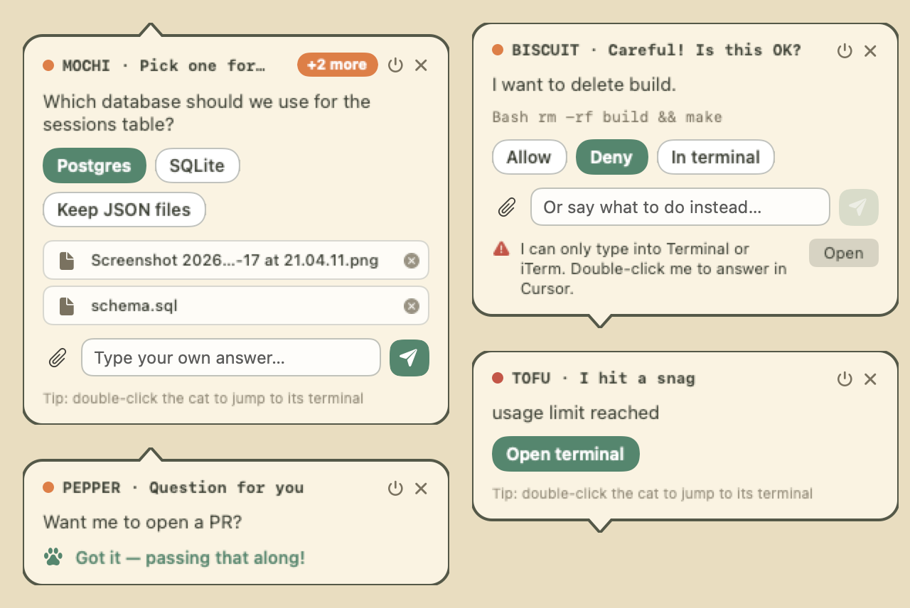

<h1 align="center">Agent Cats</h1>

<p align="center"><b>Your Claude Code and Codex sessions, as pixel cats under the macOS menu bar.</b><br>
They tell you what they need in one sentence. You answer from the bubble. No window switching.</p>

<p align="center"><a href="docs/agent-cats-reel.mp4"></a><br>
<sub><a href="docs/agent-cats-reel.mp4">Watch in full quality (MP4)</a></sub></p>

- **Approve from the cat.** Permission requests pop up with Allow, Deny or In terminal, even over full-screen apps.
- **Plain-English asks.** "I want to run the test suite." instead of a raw command (the command is still shown in small print).
- **Answer questions** with one click, or type a reply and attach files and screenshots.
- **See what got done.** The dashboard shows each task, the files changed, the commands run and the result.
- **Jump or stop.** Double-click a cat to open its terminal. Right-click › End session to stop it.
- **Private.** Everything stays on your Mac. No network calls.

## Install

Needs macOS 14+ on Apple Silicon and the Xcode command line tools (`xcode-select --install`).

```sh
git clone https://github.com/jahaanb7/agent-cats.git
cd agent-cats
./build.sh && ./install.sh
open ~/Applications/AgentCats.app
```

## Set up

1. On first launch Agent Cats opens **Connect agent hooks**. Review the change and click **Install hooks**. Your existing hooks are kept and your settings are backed up first.
2. Restart your `claude` / `codex` sessions. A cat appears for each one.
3. Optional: right-click an empty spot in the room › **Open at login**.

To type replies into Terminal.app, allow Agent Cats in **System Settings › Privacy & Security › Accessibility** when asked. iTerm2 needs nothing extra.

## Use

| Do this | To |
|---|---|
| Click a cat | Open its speech bubble |
| Double-click a cat | Jump to its terminal |
| Right-click a cat | Open terminal, details, end session |
| Click the paw or tug the rope | Show or tuck away the room |
| Double-click the rope | Hide everything until a cat needs you |
| **Dashboard ↗** | Usage, recent work and pending approvals |

<p align="center"></p>

## Uninstall

Right-click an empty spot in the room › **Disconnect hooks…**, quit, then delete `~/Applications/AgentCats.app`.

## Troubleshooting

- **Replies don't type into Terminal:** turn Agent Cats on in **System Settings › Privacy & Security › Accessibility**. Builds before 0.4.1 lost this permission on every update; if the switch looks on but sending still fails, remove Agent Cats with **−** and send again to re-add it.
- **No cats:** make sure hooks are connected (the dashboard header shows **LIVE**), then restart your agent sessions.
- **Nothing pops up:** check the room isn't hidden. Click the paw in the menu bar.
- **Logs:** `~/Library/Logs/AgentCats/startup.log` records launches and every Allow or Deny.

## Develop

```sh
./build.sh                    # build dist/AgentCats.app
./dist/agentcats selftest     # core tests
./Tests/run-socket-tests.sh   # approval socket tests
./Tests/run-room-tests.sh     # room UI tests
./package.sh                  # release zip in dist/
./Tools/make-reel.sh          # promo video in dist/ (needs ffmpeg)
```
